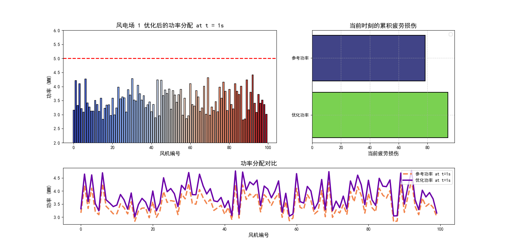

# 风电场有功功率优化分配

面向风机疲劳损伤抑制的风电场有功功率调度项目，源于2024年中国研究生数学建模竞赛A题。项目涵盖疲劳评估、载荷估算、功率调度，以及测量噪声和通信延迟处理，并进一步完善了确定性调度算法与离线验证流程。

**技术栈：** Python · MATLAB · NumPy · SciPy · 凸优化

## 建模思路

| 模块 | 解决的问题 | 方法 |
|---|---|---|
| 1.疲劳评估 | 如何从随机载荷计算疲劳指标？ | S-N曲线、Miner理论、局部极值与窗口思想 |
| 2.载荷估算 | 风机运行状态对应多大的主轴扭矩、塔架推力？ | 物理关系、空气动力学系数、误差平方和评估 |
| 3.功率调度 | 如何在完成总功率任务的同时降低损伤代价？ | 双部件代理目标、优化算法对比、KKT条件与二分搜索 |
| 4.噪声与延迟处理 | 测量不准、数据延迟时如何调度？ | 卡尔曼滤波与自回归建模思路、灰色预测、粒子群优化实验 |

载荷估算与疲劳评估提供建模基础；当前经过自动化验证的调度入口采用独立的二次代理目标，并未完整串联四个模块为物理闭环。

## 项目结果

### 竞赛阶段实验

- 低复杂度疲劳评估实验耗时约 **0.13秒**。
- 梯度下降、遗传算法及BP神经网络对应的累计疲劳损伤指标降幅分别为 **7.10%、13.20%、15.50%**。

这些数值记录竞赛阶段的实验结果；当前自动化测试不覆盖其完整实验流程。部分历史脚本依赖中间数据或特定运行环境，详情见各模块说明。

### 调度算法新增验证

| 指标 | 风场1 | 风场2 |
|---|---:|---:|
| 风机数量 | 100 | 100 |
| 调度时刻 | 2000 | 2000 |
| 相对平均分配的累计代理代价降幅 | 0.2925% | 0.2916% |
| 核心求解耗时中位数 | 约0.55 ms | 约0.55 ms |
| 本次回放最大核心求解耗时 | 约1.20 ms | 约0.65 ms |
| 最大总功率残差 | 小于1.2×10⁻¹³ MW | 小于1.2×10⁻¹³ MW |
| 单机功率越界 | 0 | 0 |

4000个调度时刻全部满足约束。每个风场抽取前20个时刻与SLSQP独立对照，目标值最大绝对差小于 **4×10⁻¹⁰**。完整指标见 [results/metrics.json](results/metrics.json)。

计时为本机核心算法耗时，不含文件I/O和通信。竞赛阶段与新增验证的基准和统计流程未统一，不能直接比较降幅；代理代价也不等于真实材料损伤或寿命变化。

## 目录

```text
src/
├── fatigue/                  # 1.疲劳评估
├── load_estimation/          # 2.载荷估算
├── dispatch/                 # 3.功率调度
│   ├── solver.py             # KKT与二分搜索求解器
│   └── experiments/          # 竞赛阶段算法实验
└── robust_dispatch/          # 4.噪声与延迟处理
scripts/
├── demo.py                   # 无外部依赖的示例
└── evaluate.py               # 原始MAT数据离线评估
tests/                        # 核心算法测试
data/                         # 数据说明与人工示例
results/                      # 验证指标与精选实验图
docs/                         # 模型说明
```

## 快速运行

Python 3.10或以上，在仓库根目录运行：

```bash
python scripts/demo.py
python -m unittest discover -s tests -v
```

上述命令仅使用Python标准库，不需要下载竞赛数据。

完整数据评估：

```bash
python -m venv .venv
# macOS / Linux
source .venv/bin/activate
# Windows可使用 .venv\Scripts\activate
pip install -r requirements.txt
python scripts/evaluate.py --data "data/附件2-风电机组采集数据.mat"
```

完整数据未上传，准备方法见 [data/README.md](data/README.md)。评估生成逐秒功率CSV、单步及累计代价CSV和指标JSON；再次运行会更新 `results/metrics.json` 中的本机计时。

`requirements.txt`用于当前调度评估入口。历史实验还可能需要pandas、Matplotlib、DEAP、PyTorch等依赖及MATLAB工具箱，不属于快速运行入口。

## 调度模型

功率单位统一为MW。固定当前风速后，最小化：

```text
sum(c_i * p_i²)
c_i = 0.5 / (v_i + 1) + 0.5 / (v_i + 2)
```

约束：

```text
sum(p_i) = P_total
0 <= p_i <= 5
abs(p_i - P_total / N) <= 1
```

目标严格凸。KKT条件给出 `p_i = clip(lambda / (2*c_i), lower, upper)`，通过64次二分搜索确定乘子lambda，在浮点精度范围内求解全局最优分配。每次迭代遍历N台风机，固定迭代次数下复杂度为O(N)。

更多说明见 [模型与验证](docs/methodology.md)。

## 实验展示

以下为竞赛阶段功率分配与损伤对比图，与新增KKT求解器的计时实验分开展示。



## 后续方向

完善载荷预测与循环计数接口，将经过标定的疲劳指标接入调度；补充有时间戳的噪声、延迟回放与独立测试集评估。
